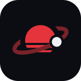
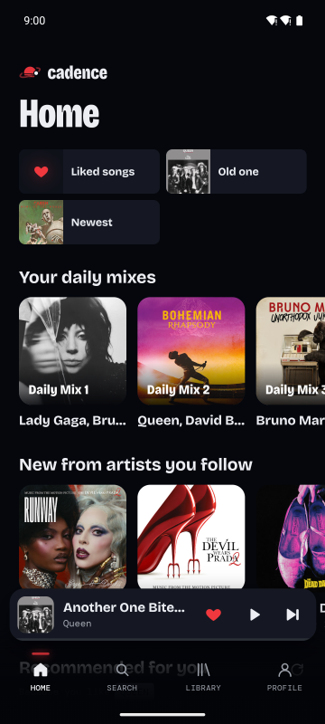
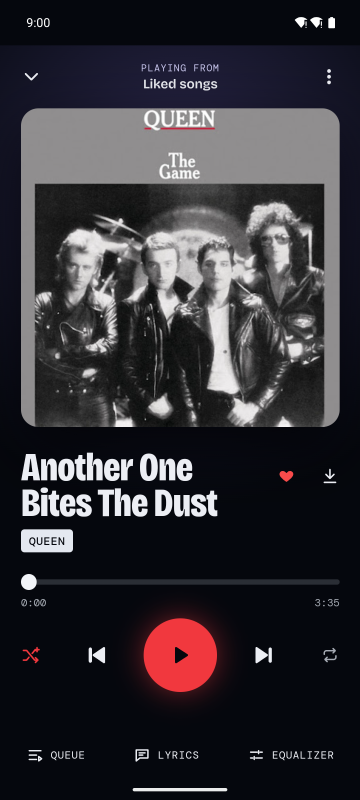
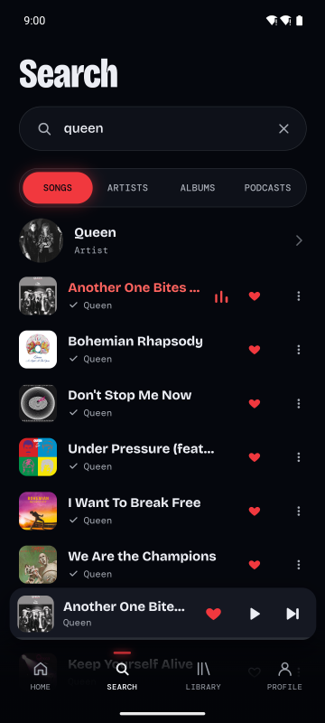
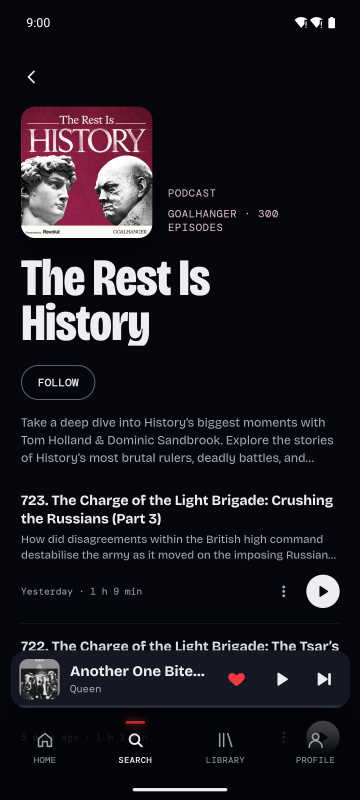
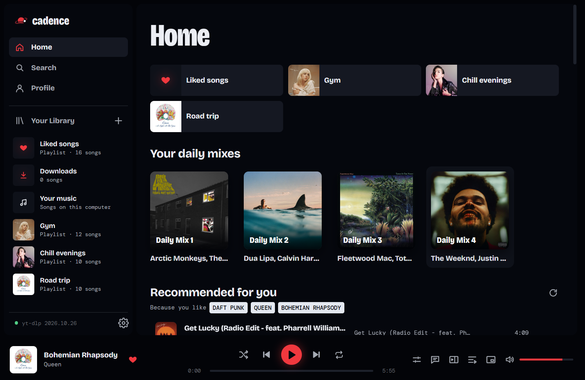

<p align="center">
  
</p>

<h1 align="center">Cadence</h1>

<p align="center">
  A fast, ad-free music player for Android and Windows.<br />
  YouTube Music's whole catalogue, your own music files and podcasts, in one clean app.
</p>

<p align="center">
  <a href="https://github.com/octavianbanarizatic-hub/Cadence-app/releases/latest"><b>Download for Android</b></a>
  ·
  <a href="#windows"><b>Windows</b></a>
  ·
  <a href="#features">Features</a>
  ·
  <a href="#how-it-works">How it works</a>
</p>

<p align="center">
  
  
  
  
</p>

<p align="center">
  
</p>

---

## Why Cadence

- **No ads, no account, no tracking.** Nothing to sign up for. Your likes, playlists and history stay on your device, with a backup every week.
- **Everything in one place.** Songs and albums from YouTube Music, the music files already on your phone, and podcasts.
- **Feels like Spotify.** Home with daily mixes and recommendations, a queue, smart shuffle, lyrics, a full-screen player and swipes.
- **Light.** About 40 MB, dark from top to bottom, and it updates itself.

## Features

**Listening**
- Search songs, artists, albums and podcasts. Your own songs (liked, downloaded, in playlists, played a lot) come first.
- Album and artist pages, with every artist of a song a tap away.
- Gapless playback and optional crossfade (up to 12 s), with a 10-band equalizer.
- Synced lyrics that follow the song, and lyric cards you can share as a picture.
- Autoplay: when a list ends, similar songs keep going.
- "Don't play this song": radio, mixes and suggestions leave out the songs you're tired of.

**Your library**
- Liked songs, playlists (with your own cover photos), and pinned playlists.
- Import playlists from YouTube, YouTube Music or Spotify links.
- Downloads for offline listening, by hand or automatically (on Wi-Fi, or on mobile data too if you like), in three qualities, all listed in Settings.
- Import the music files already on your phone.
- Find and sort inside any list.
- Backups: one every week by itself in Downloads → Cadence backups (the last four are kept), or whenever you like, and restore them anywhere.

**Made for you**
- Daily mixes built from what you play most.
- Recommendations on Home, and "New from artists you follow".
- Start radio from any song, playlist or artist.
- Smart shuffle: songs like your playlist's are mixed in, marked with a spark.
- Profile: minutes listened, top artists, songs and albums for the week, month, year or all time.
- Your year in music: a story-sized card with your minutes, top artist and top songs, to share.
- Notifications when artists and podcasts you follow put out something new, even with Cadence closed.

**Podcasts**
- Search any podcast (from Apple's public podcast directory) and follow it.
- Episodes start right where you stopped, with skip back 15 s, ahead 30 s and speeds from 0.5× to 3×.
- New episodes on Home, and episodes can be downloaded.

**Around the phone**
- Lock-screen and notification controls, a home-screen widget and Android Auto.
- Sleep timer, swipe gestures, and a floating tab bar if you like it.
- Share songs, albums and playlists with a link. Friends with Cadence open it straight in the app; everyone else gets a page with YouTube Music.
- Open YouTube and YouTube Music links in Cadence from the share menu.

**On Windows** it's the same app with the same look, laid out for a computer: a sidebar with your library, a Now Playing panel, a mini player that stays on top, media keys and keyboard shortcuts. Share copies a link, and a YouTube or Cadence link pasted into Search plays.

## Install

### Android

1. Download the latest `Cadence-x.y.z.apk` from [Releases](https://github.com/octavianbanarizatic-hub/Cadence-app/releases/latest).
2. Open it and allow your browser or file manager to install apps when Android asks.
3. That's it. Cadence tells you when a new version is out and updates itself.

It works on Android 7 and newer, on 64-bit and older 32-bit phones. Some phones (Xiaomi, for example) close apps in the background to save battery; if the music stops with the screen off, set Cadence's battery setting to "No restrictions".

### Windows

1. Download `Cadence-1.1.1-setup.exe` from the [1.1.1 release](https://github.com/octavianbanarizatic-hub/Cadence-app/releases/tag/v1.1.1) (releases that only change the phone app don't include it).
2. Run it. Windows may warn that the app isn't from a known publisher; choose "More info", then "Run anyway".
3. From then on Cadence offers new versions and installs them by itself.

## How it works

Cadence finds music through YouTube Music and plays it through [yt-dlp](https://github.com/yt-dlp/yt-dlp), which turns a song into an audio stream, so there are no ads and no account. On phones, yt-dlp runs inside the app with its own Python (through [youtubedl-android](https://github.com/JunkFood02/youtubedl-android)) and stays loaded between songs, so a new song starts in a few seconds, and songs you're likely to play next are looked up before you tap them.

Podcasts are read straight from each show's RSS feed, so episodes are the publisher's own files. Lyrics come from [LRCLIB](https://lrclib.net).

There's no server behind Cadence and no local web server either: the app streams audio to itself through a private `media://` protocol. Everything you make (likes, playlists, history, downloads) is stored on your device.

```
 Web page (src/)                          Rust core (src-tauri/src/)
 ───────────────                          ──────────────────────────
 search ──────────── invoke("search") ──▶ ytmusic.rs    YouTube Music
 <audio src="media://…/yt/ID"> ─────────▶ media.rs      yt-dlp → audio stream, fetched in ranges
 <audio src="media://…/pod/ID"> ────────▶ media.rs      podcast episode from its feed
 likes, playlists, plays ───────────────▶ db.rs         SQLite
 lyrics ────────────────────────────────▶ lyrics.rs     embedded tags, else LRCLIB
 podcasts ──────────────────────────────▶ podcasts.rs   Apple's directory + RSS
 Android-only parts ────────────────────▶ android-plugin (Kotlin): yt-dlp, media session,
                                           widget, Android Auto, file import, backups,
                                           new release checks
```

It's built with [Tauri 2](https://tauri.app): a Rust core and a plain TypeScript page, no framework.

## Project layout

| Path | What's there |
| --- | --- |
| `src/` | The page: `main.ts` (screens), `player.ts` (queue, gapless, crossfade, shuffle), `podcasts.ts`, `phone.css` (the phone layout and the parts the desktop shares), `desktop.css` (the desktop layout) |
| `src-tauri/src/` | The Rust core: YouTube Music, yt-dlp, streaming, database, podcasts, lyrics, downloads, sharing, updates |
| `src-tauri/android-plugin/` | Android-only parts in Kotlin |
| `src-tauri/gen/android/` | The Android project |
| `share-page/` | The page shared links open, published on GitHub Pages |

## A note on YouTube

Cadence isn't affiliated with or endorsed by YouTube, Google, Spotify or Apple. Playing YouTube without its official player goes against YouTube's Terms of Service. Cadence is a personal, non-commercial project for educational use; use it at your own discretion.

## License

Cadence is free software under the [GNU General Public License v3.0](LICENSE). You can use, study, share and change it; if you share a changed version, share its source code too, under the same license.
